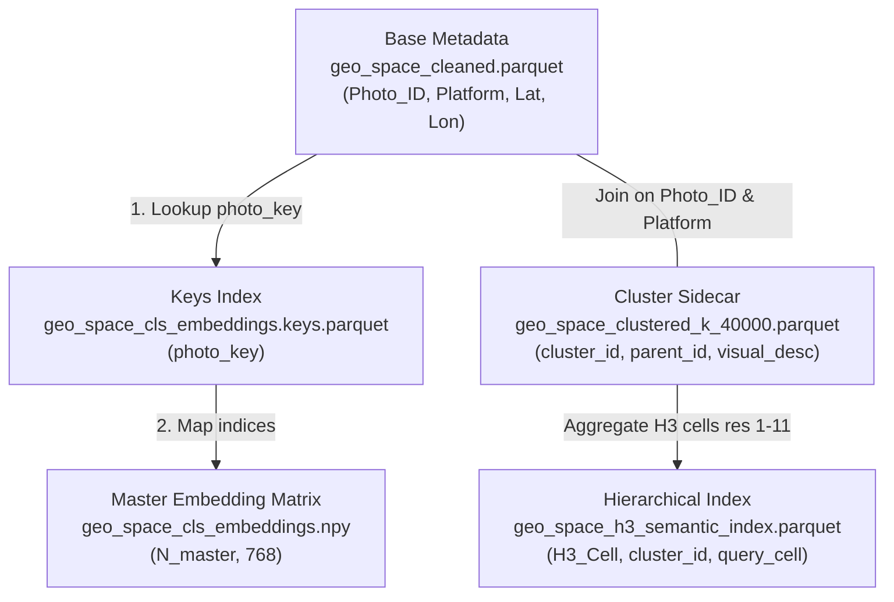

# Geo-RAG Dataset Structure & Guide

This document describes the structure, formats, and design of the dataset outputs generated by the Geo-RAG spatial-semantic mapping pipeline.

> [!TIP] New to Geo-RAG?
> For a friendly, visual introduction to why embeddings, metadata, and clusters are stored in separate files, see the **[Preliminaries & Core Concepts Guide](preliminaries.md)**.

---

## 📂 File Directory & Descriptions

| File Name | Format | Approximate Size | Description |
| :--- | :--- | :--- | :--- |
| **`geo_space.parquet`** | Apache Parquet | ~300 MB | Raw unified metadata table compiled across all scraping platforms (Flickr, Mapillary, iNaturalist, Wikiloc). |
| **`geo_space_deduplicated.parquet`** | Apache Parquet | ~250 MB | Core metadata of all scraped images after duplicate coordinates and identical images are pruned. |
| **`geo_space_cleaned.parquet`** | Apache Parquet | ~227 MB | Cleaned online base metadata subset, generated by filtering out coordinate locking anomalies (GPS glitches). **This is the primary base metadata file for downstream tasks.** |
| **`geo_space_cleaned_offline.parquet`** | Apache Parquet | ~227 MB | Offline metadata table synchronized with the cleaned dataset for zero-inference offline operation and local image storage. |
| **`geo_space_{representation_type}_embeddings.npy`** | NumPy Binary Matrix | ~7.9 GB / ~15.9 GB | Decoupled master feature representations matrix for the default TIPSv2 model (e.g. `geo_space_cls_embeddings.npy` or `geo_space_cls_avg_patch_embeddings.npy`). |
| **`geo_space_{model_name}_{representation_type}_embeddings.npy`** | NumPy Binary Matrix | Variable (~4–16 GB) | Decoupled master feature representations matrix for an alternative vision encoder (e.g. `geo_space_vit_base_patch16_dinov3.lvd1689m_cls_embeddings.npy`, `geo_space_facebook_dinov2-base_cls_embeddings.npy`). **Master embeddings always retain the core `geo_space` prefix.** |
| **`geo_space_{model_name}_{representation_type}_embeddings.keys.parquet`** | Apache Parquet | ~45 MB | Companion keys index mapping each row of the `.npy` matrix to its stable `photo_key` string (`{platform}_{photo_id}`). Enables instant dynamic subset slicing for any downstream parquet (`cleaned`, `offline`, `clustered`). |
| **`geo_space_clustered_k_{num_clusters}.parquet`** | Apache Parquet | ~2.0 GB | Decoupled cluster sidecar containing `cluster_id`, VLM-generated visual descriptions, and parent mapping nodes for `num_clusters` clusters. |
| **`geo_space_{model_slug}_{representation_type}_{precision}_clustered_k_{k}.parquet`** | Apache Parquet | ~2.0 GB | Namespaced cluster sidecar produced when clustering alternative vision backbone representations (located inside subfolder `vis_{k}_{model_slug}_{representation_type}_{precision}/`). |
| **`geo_space_h3_semantic_index.parquet`** | Apache Parquet | ~3.7 MB | Aggregated lookup index mapping H3 cells across resolutions 1 through 11 to their dominant semantic categories, seasons, and cluster IDs. |
| **`cluster_samples_k_{num_clusters}.html`** | HTML/JS Dashboard | ~40 KB | Standalone interactive visual dashboard showing representative images, VLM labels, and outlier boundaries for each cluster. |
| **`cluster_samples_k_{num_clusters}_data.js`** | JavaScript Object | ~291 MB | Data payload powering the visual dashboard, containing coordinate and metadata mappings for cluster centroids. |
| **`cluster_semantic_scatter_k_{num_clusters}.html`** | HTML/JS Plot | ~40 MB | Interactive 2D UMAP scatter plot showing the semantic relationships and visual grouping of the `num_clusters` cluster centroids. |
| **`cluster_semantic_scatter_k_{num_clusters}.png`** | Static Image | ~6.6 MB | Static high-resolution rendering of the UMAP semantic clustering layout. |
| **`global_cluster_map.html`** | Leaflet Map | ~35 MB | Interactive map displaying centroid coordinates, markers, and metadata descriptions of clusters globally. |
| **`global_dataset_map.html`** | Leaflet Map | ~11 MB | Global visualization of all deduplicated metadata sample coordinates. |
| **`global_h3_occupancy_map.html`** | Leaflet Map | ~23 MB | Aggregated global density map showing data volume per H3 hexagon. |
| **`global_h3_semantic_map.html`** | Leaflet Map | ~1 MB | Global categorical thematic map displaying spatial distributions of semantic classes. |
| **`global_dataset_stats.png`** / **`.txt`** | Stats Plot & Report | ~380 KB / ~6 KB | Overall summary reports, count statistics, and distribution plots of the dataset. |
| **`cluster_count_validation.png`** | Plot | ~77 KB | Silhouette/Elbow validation plot used for optimal cluster count estimation. |

> [!NOTE]
> `{num_clusters}` represents the total number of clusters (configured via the `k` parameter in `params.yaml`). The sizes and files documented above are examples from a pipeline run with `num_clusters = 40,000`.
> Model names in file slugs replace forward slashes with underscores (e.g. `facebook/dinov2-base` $\rightarrow$ `facebook_dinov2-base`).

---

## 📐 Decoupled Storage Architecture

To conserve SSD storage and system RAM, the dataset uses a **decoupled architecture** where heavy embedding matrices, base metadata, and cluster mappings are stored separately but remain mathematically linked:



1. **Mapping via `photo_key` Hash-Map:**
   To avoid data redundancy, only a single master embedding `.npy` matrix (generated at the deduplication step) is stored on disk.
   Alongside the matrix, a lightweight companion `.keys.parquet` file contains the ordered list of stable unique keys (`photo_key`, constructed as `Platform_Photo_ID`). When metadata is cleaned, filtered, or clustered, the loader dynamically reads the keys from the metadata file and performs a fast C-accelerated index lookup (`pd.Index.get_indexer`) against the master keys index to retrieve the correct row indices and slice the memory-mapped matrix in less than 0.3 seconds.

2. **Sidecar Merging:**
   The cluster assignments parquet (`geo_space_clustered_k_40000.parquet`) does not duplicate heavy coordinates or URLs. It links back to the base metadata using the primary key: `['Platform', 'Photo_ID']`.

3. **Multi-Representation Extensibility:**
   Because the heavy visual features are decoupled from the metadata tables, this architecture natively supports multiple representation types (e.g. `patch_embeddings`, text features, or alternative vision backbones). Additional representation matrices of shape `(N, D_new)` can be saved as independent companion `.npy` files and aligned row-for-row using their matching keys index.

4. **Offline Datasets & Camera Trap Archives:**
   The pipeline seamlessly ingests self-contained offline image archives alongside online web-scraped data:
   - **Offline Directory Layout**: Offline datasets (e.g. `snapshot_usa_2024`, `iwildcam_subset`) store local assets in structured subfolders (e.g. `images/<platform>/<photo_id>.jpg`) referenced by `Image_Location` in their companion `.parquet` or `.csv` metadata.
   - **Dynamic Local Path Resolution**: During ingestion and evaluations, `resolve_offline_image_path` dynamically resolves local image paths across flat layouts, `train/` folders, platform subdirectories, and nested directory trees.
   - **Automatic Platform Licensing**: Missing licenses for camera trap sensors are automatically backfilled (`CC0` for Snapshot USA, `CDLA-Permissive-1.0` for iWildCam).
   - **Bulk Downloader Utility**: For details on converting online dataset tables into localized offline directory structures with streaming checkpoints and companion embeddings, see the [Offline Image Downloader Guide](dataset/download_images.md).

5. **Offline Dataset & Multi-Model Embeddings Synchronization:**
   When the master online dataset (`geo_space_cleaned.parquet`) is updated (e.g. from coordinate anomaly or sequence cleaning), offline datasets (`geo_space_cleaned_offline.parquet`) can be reconciled using `src/utils/sync_offline_dataset.py`:
   - **Model-Agnostic Discovery**: Automatically identifies all companion embedding files (`*_embeddings.keys.parquet` and `*_embeddings.npy`) and clustered sidecars (`*_clustered_k_*.parquet`) matching the offline base name across any model architecture (TIPSv2, DINOv2, SigLIP, Swin, etc.).
   - **Zero-Inference Matrix Slicing & Sidecar Pruning**: Slices `.npy` embedding matrices via memory mapping and reconciles companion clustered sidecars to surviving keys without GPU inference or re-clustering.
   - **Orphaned Image Cleanup**: Optionally removes physical `.jpg` files for purged records (`--delete_images`).

6. **Embedding File Naming Convention & Core Base Invariant:**
   The logic for locating and loading model embedding files follows a consistent, unambiguous rule:
   > **Embedding matrices are always named with the core prefix:**
   > `geo_space_{model_name}_{representation_type}_embeddings.npy`
   > (along with companion `geo_space_{model_name}_{representation_type}_embeddings.keys.parquet`).
   >
   > For the default vision encoder (TIPSv2), embedding files are named:
   > `geo_space_{representation_type}_embeddings.npy` (e.g. `geo_space_cls_embeddings.npy`) or `geo_space_google_tipsv2-b14_{representation_type}_embeddings.npy`.

   - **No Pipeline Suffixes on Embeddings**: Stage modifiers such as `_cleaned`, `_offline`, `_deduplicated`, or `_filtered` belong **solely to the metadata Parquet files** (e.g., `geo_space_cleaned_offline.parquet`), never to the master embedding matrix.
   - **Zero-Redundancy Dynamic Slicing**: When loading embeddings for `geo_space_cleaned_offline.parquet` or `geo_space_cleaned.parquet`, loaders (`load_embeddings` and `backfill_embeddings`) automatically strip pipeline suffixes via `get_core_base_name` to locate `geo_space_{model_name}_{representation_type}_embeddings.npy`, and slice the rows on the fly in memory using the companion `.keys.parquet` index.

---

## 🐍 Loading Data in Python

Always load the data using the provided backward-compatible utility functions in `src/utils/io.py` to ensure sidecars and embeddings are resolved and merged transparently.

### 1. Loading Metadata + Cluster Columns

The helper automatically resolves path mappings, loads the base metadata, and merges the cluster sidecar columns transparently (the cluster count `k` is automatically extracted from the sidecar's filename):

```python
from src.utils.io import load_dataset_with_clusters

# Pass the sidecar path directly; it auto-detects the cluster count (k) from the filename!
df = load_dataset_with_clusters(
    "full_pipeline_output/geo_space_clustered_k_40000.parquet"
)

# df will contain: 'Latitude', 'Longitude', 'Image_URL', 'cluster_id', 'cluster_label', etc.
print(df.shape)
```

### 2. Loading Embeddings Matrix

The embeddings loader (`load_embeddings`) automatically resolves companion `.npy` paths. It loads the master file (e.g. `geo_space_cls_embeddings.npy` or `geo_space_vit_base_patch16_dinov3.lvd1689m_cls_embeddings.npy`) and slices it dynamically by looking up the metadata `photo_key` against the companion `.keys.parquet` index:

```python
from src.utils.io import load_embeddings

# 1. Load default TIPSv2 embeddings (auto-slices master matrix to match parquet rows)
embeddings_tips = load_embeddings(
    "full_pipeline_output/geo_space_cleaned.parquet",
    representation_type="cls",  # "cls", "avg_patch", or "cls_avg_patch"
)
print("TIPSv2 shape:", embeddings_tips.shape)  # (N_cleaned, 768)

# 2. Load alternative vision backbone embeddings (e.g. DINOv3) for an offline dataset
# Automatically resolves to geo_space_vit_base_patch16_dinov3.lvd1689m_cls_embeddings.npy
embeddings_dinov3 = load_embeddings(
    "data/database/geo_space_cleaned_offline.parquet",
    model_name="vit_base_patch16_dinov3.lvd1689m",
    representation_type="cls",
)
print("DINOv3 shape:", embeddings_dinov3.shape)  # (N_offline, 768)
```
